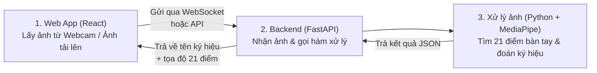

# BÁO CÁO ĐỒ ÁN MÔN HỌC: THỊ GIÁC MÁY TÍNH
**Đề tài:** Xây dựng Web App nhận diện ngôn ngữ ký hiệu qua Camera

---

## 1. Giới thiệu đề tài & Phân công công việc

### 1.1. Lý do chọn đề tài
Người khiếm thính gặp nhiều khó khăn khi giao tiếp với những người không biết ngôn ngữ ký hiệu. Vì vậy, nhóm em chọn đề tài **"Xây dựng Web App nhận diện ngôn ngữ ký hiệu qua Camera"** để ứng dụng kiến thức môn Thị giác máy tính vào thực tế. Ứng dụng giúp nhận diện các cử chỉ tay cơ bản qua webcam (hoặc ảnh/video tải lên), chuyển thành chữ viết và đọc thành tiếng.

### 1.2. Mục tiêu của nhóm
- Nhận diện được **12 cử chỉ giao tiếp thông dụng** (Xin chào, Cảm ơn, Tôi yêu bạn, OK, Đồng ý, Không đồng ý, Xin lỗi, Tạm biệt, Gọi cho tôi, Chú ý, Cần giúp đỡ, Dừng lại).
- Cho phép người dùng **tự dạy thêm ký hiệu mới** và lưu vào database.
- Ghép các từ nhận diện được thành câu và **đọc phát âm (Tiếng Việt / Tiếng Anh)**.
- Có chế độ **test không cần webcam** (dùng ảnh tải lên, dán ảnh `Ctrl+V`, hoặc giả lập bàn tay 21 điểm) và **chụp ảnh màn hình (Screenshot)** kết quả.

### 1.3. Phân công công việc (Nhóm 3 người)

| Thành viên | Phần phụ trách | File code chính | Công việc cụ thể |
| :--- | :--- | :--- | :--- |
| **Thành viên 1** | **Phần Python (Xử lý ảnh & Nhận diện)** | [sign_detector.py](file:///d:/Study/thi-giac-mt/sign_detector.py) [test_no_cam.py](file:///d:/Study/thi-giac-mt/test_no_cam.py) | Dùng OpenCV và MediaPipe lấy 21 điểm mốc trên bàn tay, tính góc ngón tay để biết ngón nào đang duỗi hay gập, phân loại 12 ký hiệu và viết file test tự động. |
| **Thành viên 2** | **Phần API & Database (Backend)** | [main.py](file:///d:/Study/thi-giac-mt/main.py) [gestures.db](file:///d:/Study/thi-giac-mt/gestures.db) | Viết server bằng FastAPI, tạo kết nối WebSocket để nhận ảnh liên tục từ web gửi về, viết các API lưu lịch sử, thêm/xóa ký hiệu mới vào SQLite và lưu ảnh chụp màn hình. |
| **Thành viên 3** | **Phần Web App (Frontend)** | [App.tsx](file:///d:/Study/thi-giac-mt/thigiacmt/src/App.tsx) [App.css](file:///d:/Study/thi-giac-mt/thigiacmt/src/App.css) | Làm giao diện bằng React + TypeScript, bật webcam, vẽ khung xương bàn tay lên thẻ `<canvas>`, ghép từ thành câu, đọc giọng nói và làm công cụ test khi không có cam. |

---

## 2. Sơ đồ hoạt động của hệ thống

Luồng chạy của chương trình rất đơn giản gồm 3 bước chính:

---

## 3. Nội dung chi tiết từng phần

### Phần 1: Xử lý ảnh và Nhận diện ký hiệu bằng Python (Thành viên 1)
- **Công cụ sử dụng:** Thư viện `opencv-python`, `mediapipe` (bản Tasks Vision với model [hand_landmarker.task](file:///d:/Study/thi-giac-mt/models/hand_landmarker.task)), `numpy`.
- **Các bước xử lý trong [sign_detector.py](file:///d:/Study/thi-giac-mt/sign_detector.py):**
  1. **Đọc ảnh và đổi hệ màu:** Ảnh gửi từ web về được OpenCV đọc ra hệ màu `BGR`, sau đó đổi sang `RGB` bằng `cv2.cvtColor()` để đưa vào MediaPipe.
  2. **Lấy 21 điểm trên bàn tay:** MediaPipe trả về tọa độ $(x, y, z)$ của 21 khớp tay (từ cổ tay điểm số `0` đến các đầu ngón tay điểm `4, 8, 12, 16, 20`), nhận diện tối đa 2 bàn tay cùng lúc.
  3. **Kiểm tra ngón tay duỗi hay gập ([`analyze_fingers`](file:///d:/Study/thi-giac-mt/sign_detector.py#L280-L339)):**
     - Thay vì chỉ so sánh tọa độ $y$ cao hay thấp (dễ bị sai khi để tay xa hoặc gần cam), em tính **khoảng cách từ đầu ngón tay đến cổ tay** chia cho độ rộng lòng bàn tay, kết hợp với **góc ở khớp giữa ngón tay**.
     - Nếu góc khớp $> 130^\circ$ và đầu ngón tay vươn xa cổ tay hơn khớp giữa thì tính là ngón đang **Duỗi**, ngược lại là **Gập**.
  4. **Nhận diện 12 ký hiệu ([`classify_single_hand`](file:///d:/Study/thi-giac-mt/sign_detector.py#L341-L426)):**
     - Dựa vào tổ hợp 5 ngón tay duỗi/gập để suy ra ký hiệu:
       - Duỗi cả 5 ngón và xòe rộng $\to$ **Xin chào (`hello`)**.
       - Duỗi 5 ngón nhưng khép sát các ngón vào nhau $\to$ **Cảm ơn (`thank_you`)**.
       - Duỗi ngón cái, trỏ, út $\to$ **Tôi yêu bạn (`i_love_you`)**.
       - Đầu ngón cái chạm đầu ngón trỏ, 3 ngón kia duỗi $\to$ **OK (`ok`)**.
       - Nắm 4 ngón, ngón cái chỉ lên $\to$ **Đồng ý (`yes_good`)**, chỉ xuống $\to$ **Không đồng ý (`no_bad`)**, nắm hết cả 5 ngón $\to$ **Xin lỗi (`sorry`)**.
       - Giơ 2 ngón chữ V $\to$ **Tạm biệt (`peace`)**, giơ ngón cái và út $\to$ **Gọi cho tôi (`call_me`)**, giơ 1 ngón trỏ $\to$ **Tôi/Chú ý (`point_one`)**, giơ 3 ngón giữa (hoặc kết hợp 2 tay) $\to$ **Cần giúp đỡ (`help`)**, duỗi 4 ngón gập ngón cái $\to$ **Dừng lại (`stop`)**.
  5. **Học ký hiệu mới:** Khi người dùng tự tạo ký hiệu mới, em lấy tọa độ 21 điểm trừ đi tọa độ cổ tay để đưa về gốc chuẩn, lưu thành mảng 42 số. Khi nhận diện, chương trình tính khoảng cách giữa tay hiện tại với mẫu đã lưu, nếu sai số nhỏ ($< 0.22$) thì nhận diện là ký hiệu đó.

---

### Phần 2: Xây dựng API Backend và Database (Thành viên 2)
- **Công cụ sử dụng:** `FastAPI`, `Uvicorn`, `WebSocket`, `SQLite3`.
- **Các công việc đã làm trong [main.py](file:///d:/Study/thi-giac-mt/main.py):**
  1. **Truyền nhận thời gian thực bằng WebSocket (`/ws/detect`):**
     - Vì camera gửi ảnh liên tục khoảng 10 khung hình/giây, nếu chỉ dùng HTTP thường sẽ bị chậm. Em dùng WebSocket để giữ kết nối liên tục giữa React và Python: Web gửi chuỗi ảnh Base64 lên $\to$ Python giải mã và chạy hàm nhận diện $\to$ trả ngay kết quả JSON về trong khoảng `15 - 24ms`.
  2. **Các API REST phụ trợ:**
     - `GET /api/signs`: Lấy danh sách tất cả ký hiệu (gồm 12 ký hiệu có sẵn + ký hiệu người dùng tự thêm).
     - `POST /api/detect`: Nhận diện từ 1 bức ảnh tải lên hoặc dán từ clipboard.
     - `POST /api/detect-landmarks`: Nhận trực tiếp tọa độ 21 điểm để phục vụ chế độ test khi máy không có webcam.
     - `POST /api/custom-signs` & `DELETE /api/custom-signs/{id}`: Lưu hoặc xóa ký hiệu tự dạy.
     - `GET / POST / DELETE /api/history`: Xem, lưu và xóa lịch sử các từ vừa nhận diện.
     - `GET / POST / DELETE /api/screenshots`: Nhận ảnh chụp màn hình từ Web gửi lên và lưu thành file `.png` trong thư mục `screenshots/`.
  3. **Thiết kế Database SQLite ([gestures.db](file:///d:/Study/thi-giac-mt/gestures.db)):**
     - Bảng `custom_signs`: Lưu thông tin ký hiệu tự thêm (`id`, `label_vi`, `label_en`, `emoji`, `how_to`, `feature_vector`).
     - Bảng `detection_history`: Lưu lịch sử nhận diện (`id`, `sign_id`, `label_vi`, `confidence`, `created_at`).

---

### Phần 3: Giao diện Web App bằng React + TypeScript (Thành viên 3)
- **Công cụ sử dụng:** `React`, `TypeScript`, `Vite`, `HTML5 Canvas`, `Web Speech API`.
- **Các chức năng đã làm trong [App.tsx](file:///d:/Study/thi-giac-mt/thigiacmt/src/App.tsx):**
  1. **Màn hình Camera và vẽ khung xương 21 điểm:**
     - Dùng `navigator.mediaDevices.getUserMedia` để bật webcam và đặt một thẻ `<canvas>` đè lên trên thẻ `<video>`.
     - Khi nhận được tọa độ 21 điểm từ Backend trả về, em dùng hàm `ctx.lineTo()` và `ctx.arc()` để vẽ các đường nối xương bàn tay, đóng khung quanh bàn tay và hiện nhãn `Tay Trái / Tay Phải`.
  2. **Ghép từ thành câu và đọc giọng nói (Text-to-Speech):**
     - Để tránh việc lúc đang đổi tư thế tay bị nhận diện nhầm, em cài đặt cơ chế **giữ tay ổn định khoảng 0.85 giây** (có thanh tiến trình chạy đủ 100%) thì mới chốt từ đó đưa vào ô **Ghép câu**.
     - Tích hợp `window.speechSynthesis` của trình duyệt để tự động đọc từ vừa nhận diện bằng giọng Tiếng Việt hoặc đọc cả câu bằng Tiếng Việt / Tiếng Anh.
  3. **Chế độ Test không cần Camera & Chụp Screenshot:**
     - **Chạy Auto-Test:** Tự động phát luồng khung xương giả lập qua 12 ký hiệu gửi về Backend để test khi máy không gắn webcam.
     - **Tải ảnh/video hoặc bấm `Ctrl + V`:** Cho phép chọn ảnh từ máy hoặc dán ảnh chụp màn hình trực tiếp vào web để nhận diện.
     - **Tự gập/duỗi từng ngón tay:** Có 5 nút bấm tương ứng 5 ngón tay để bật/tắt và kiểm tra xem thuật toán Python đoán ra chữ gì.
     - **Chụp Screenshot:** Ghép hình ảnh hiện tại + khung xương + tên ký hiệu + thời gian thành 1 tấm ảnh `.png` để tải về hoặc lưu vào bộ sưu tập.
  4. **Trang Từ điển & Trang Tự dạy ký hiệu mới:**
     - Hiển thị danh sách các ký hiệu kèm hướng dẫn cách đặt ngón tay, và form cho phép chụp 21 điểm của bàn tay hiện tại để đặt tên lưu thành ký hiệu mới.

---

## 4. Kết quả đạt được & Hướng phát triển

### 4.1. Kết quả chạy thử nghiệm
- Nhóm đã chạy kiểm thử bằng file [test_no_cam.py](file:///d:/Study/thi-giac-mt/test_no_cam.py) và thử trực tiếp trên giao diện Web:
  - Nhận diện đúng **12/12 ký hiệu** cơ bản với độ tin cậy từ **90% – 98%**.
  - Tốc độ xử lý mỗi khung hình nhanh (khoảng **15 – 25ms**), khi dùng trên web không bị giật lag.
  - Các chức năng ghép câu, đọc phát âm Tiếng Việt/Anh, lưu lịch sử SQLite và chụp ảnh màn hình đều hoạt động ổn định.

### 4.2. Hạn chế & Hướng phát triển
- **Hạn chế:** Hiện tại hệ thống chủ yếu nhận diện các **ký hiệu tĩnh** (dựa trên hình dáng bàn tay tại 1 thời điểm), chưa nhận diện được các ký hiệu cần chuyển động cả cánh tay theo chuỗi dài.
- **Hướng phát triển:** Thu thập thêm dữ liệu chuỗi thời gian và áp dụng mô hình học sâu (như LSTM) để nhận diện được các câu ký hiệu động phức tạp hơn.
