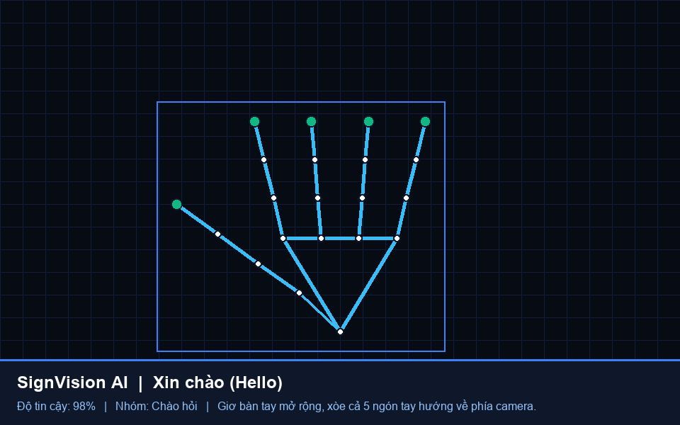
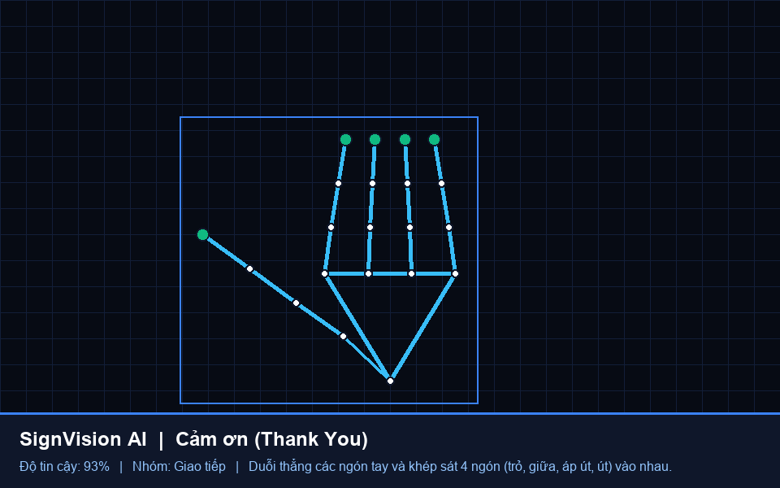
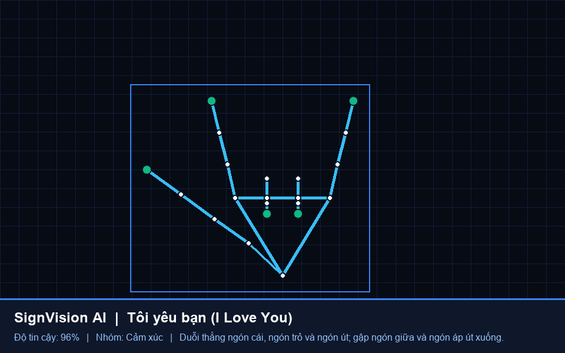
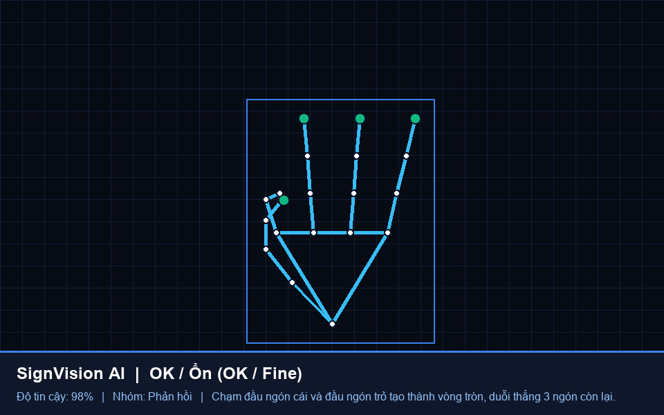
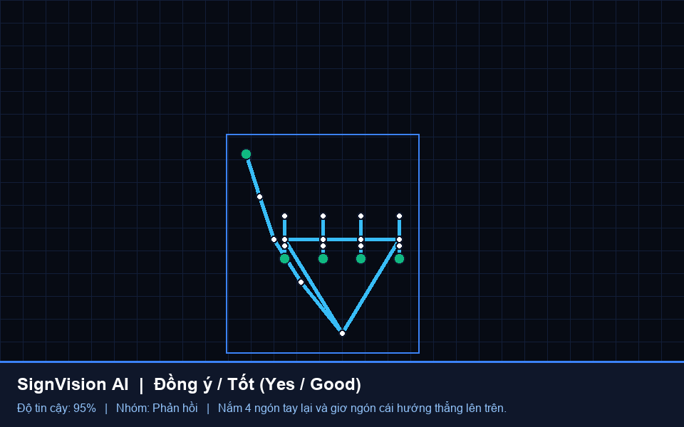
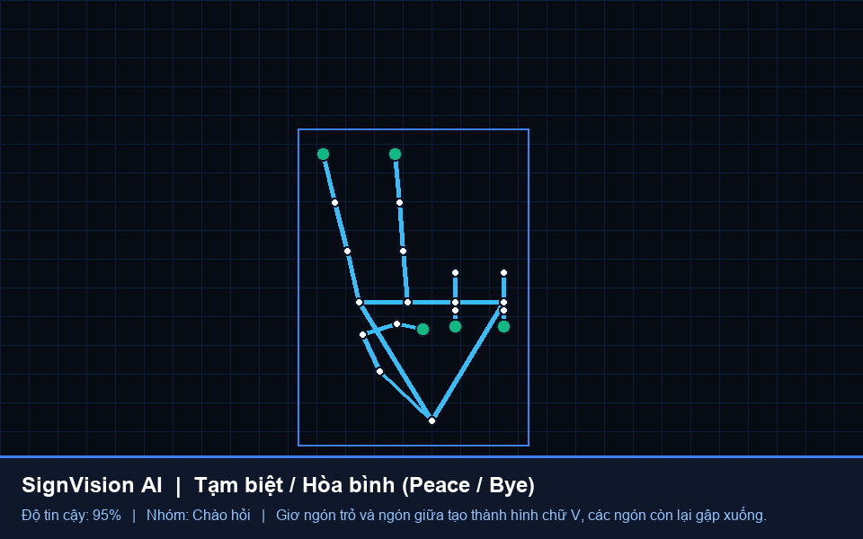

# 🤟 SignVision AI — Hệ thống Nhận diện Ngôn ngữ Ký hiệu qua Camera

Ứng dụng Web thời gian thực nhận diện **Ngôn ngữ Ký hiệu Giao tiếp Thông dụng** sử dụng **React + TypeScript (Vite)** kết nối với **Python Backend (FastAPI + OpenCV + MediaPipe HandLandmarker 21 3D Points)**.

Đặc biệt, dự án tích hợp sẵn **Bộ Công cụ Kiểm thử Không Cần Camera (No-Cam Test Suite)** và tính năng **Chụp màn hình kết quả (Screenshot)** trực tiếp trên giao diện.

---

## 📸 Hình ảnh Kết quả Nhận diện (Screenshots)

| 👋 Xin chào (`hello` - 98%) | 🙏 Cảm ơn (`thank_you` - 93%) |
| :---: | :---: |
|  |  |

| 🤟 Tôi yêu bạn (`i_love_you` - 96%) | 👌 OK / Ổn (`ok` - 98%) |
| :---: | :---: |
|  |  |

| 👍 Đồng ý / Tốt (`yes_good` - 95%) | ✌️ Tạm biệt / Hòa bình (`peace` - 95%) |
| :---: | :---: |
|  |  |

---

## ✨ Tính năng Chính

1. **Nhận diện 12 Ký hiệu Giao tiếp Thông dụng + Ký hiệu Tùy chỉnh**:
   - `👋 Xin chào`, `🙏 Cảm ơn`, `🤟 Tôi yêu bạn`, `👍 Đồng ý / Tốt`, `👎 Không đồng ý`, `👌 OK / Ổn`, `✊ Xin lỗi`, `✌️ Tạm biệt / Hòa bình`, `🤙 Gọi cho tôi`, `☝️ Tôi / Chú ý`, `🆘 Cần giúp đỡ`, `✋ Dừng lại`.
2. **Hỗ trợ Kiểm thử Toàn diện Khi Chưa Có Webcam (No-Cam Mode)**:
   - **🤖 Chạy Luồng Auto-Test**: Giả lập luồng khung xương bàn tay chuyển động tự nhiên gửi liên tục về Python Backend (`/api/detect-landmarks`) để kiểm thử tốc độ xử lý, ghép câu tự động và phát âm.
   - **📁 Tải Ảnh / Video hoặc Dán Ảnh (`Ctrl + V`)**: Tải file ảnh/video từ máy tính hoặc dán trực tiếp ảnh chụp màn hình (`Ctrl + V`) để MediaPipe phân tích.
   - **🖐️ Bàn tay Tương tác 5 Ngón**: Tự bấm gập/duỗi từng ngón tay (`Cái`, `Trỏ`, `Giữa`, `Áp út`, `Út`) để kiểm chứng thuật toán hình học trên Python Backend.
   - **🧪 Kịch bản Kiểm thử Авто (`test_no_cam.py`)**: Kiểm tra tự động 12/12 ký hiệu qua dòng lệnh và xuất ảnh báo cáo vào `screenshots/`.
3. **📸 Chụp Ảnh Màn hình Kết quả (Screenshot Gallery)**:
   - Chụp và ghép khung hình hiện tại + khung xương 21 điểm + hộp thông tin nhận diện + nhãn thời gian thành file `.png` lưu vào thư mục `screenshots/` và hiển thị ngay trên Web.
4. **💬 Ghép câu Giao tiếp & Phát âm (Text-to-Speech)**:
   - Tự động ghép các ký hiệu thành câu hoàn chỉnh và phát âm tiếng Việt (`vi-VN`) hoặc tiếng Anh (`en-US`).
5. **✨ Tự huấn luyện Ký hiệu mới (Custom Sign Trainer - SQLite)**:
   - Chụp mẫu vector 21 điểm mốc chuẩn hóa và lưu ký hiệu mới vào cơ sở dữ liệu `gestures.db`.

---

## 🚀 Hướng dẫn Cài đặt & Chạy Dự án

### 1. Khởi chạy Python Backend (FastAPI + MediaPipe)
```powershell
.\venv\Scripts\python.exe main.py
```
- Máy chủ API & WebSocket chạy tại: `http://127.0.0.1:8008`

### 2. Khởi chạy React Frontend (Vite)
```powershell
cd thigiacmt
npm install
npm run dev
```
- Mở trình duyệt tại: `http://localhost:5173`

### 3. Chạy Kiểm thử Không Cần Camera bằng CLI
```powershell
.\venv\Scripts\python.exe test_no_cam.py
```
